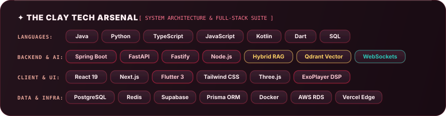
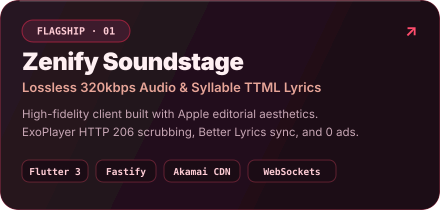
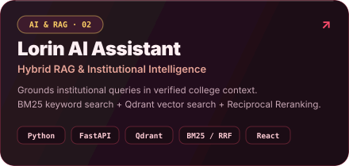
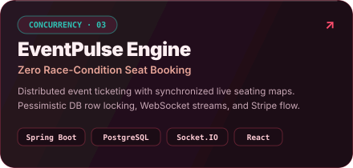
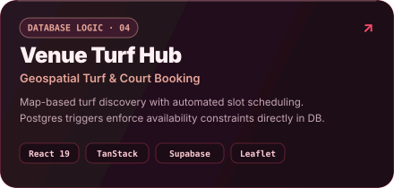
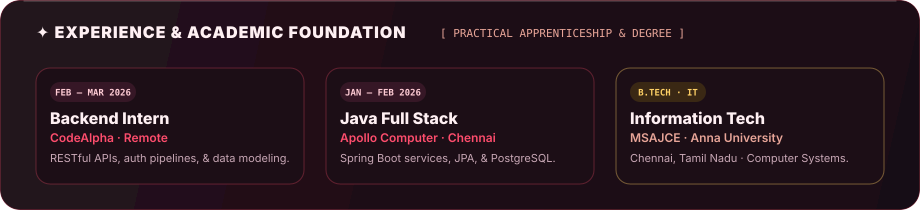
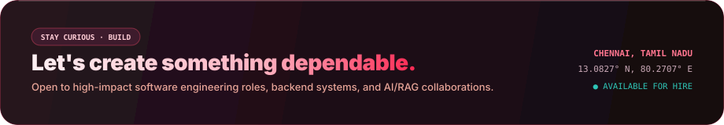

   

  <!-- Master Hero Animated Banner -->
  

    

  <!-- Clay & Strawberry Interactive Action Buttons -->
  

    
    &nbsp;&nbsp;
    
    &nbsp;&nbsp;
    
  

  

    <code>JAVA</code> &nbsp;•&nbsp; <code>SPRING BOOT</code> &nbsp;•&nbsp; <code>PYTHON</code> &nbsp;•&nbsp; <code>TYPESCRIPT</code> &nbsp;•&nbsp; <code>FASTIFY</code> &nbsp;•&nbsp; <code>FLUTTER</code> &nbsp;•&nbsp; <code>HYBRID RAG</code>
  

   

<!-- Flagship Acoustic Soundstage: Zenify -->

  

 

  

 

<!-- About & POV -->

  <h2>Curiosity first. Engineering always.</h2>
  

    I'm <b>Ramanathan</b>, an Information Technology student at <b>Mohamed Sathak A.J. College of Engineering</b> (MSAJCE), Chennai. 
    I design and build software systems that scale cleanly: high-performance APIs, database architectures, real-time concurrency engines, and hybrid retrieval-augmented generation (RAG) pipelines.
  

 

<!-- Engineering POV Bento -->
<table width="100%">
  <tr>
    <td width="33%" valign="top">
      
01 — STRUCTURE

      <h3>Think in Systems</h3>
      
Understand data flow, transactional boundaries, failure points, and trade-offs before introducing complexity.

    </td>
    <td width="33%" valign="top">
      
02 — EXECUTION

      <h3>Build for Real Use</h3>
      
Turn theoretical designs into dependable, testable production software with intuitive ergonomics.

    </td>
    <td width="34%" valign="top">
      
03 — ITERATION

      <h3>Refine the Details</h3>
      
Profile latency, measure throughput, and relentlessly eliminate bottlenecks in data and network layers.

    </td>
  </tr>
</table>

 

  

 

<!-- The Clay Tech Arsenal -->

  

 

  

 

<!-- Selected Projects Section -->

  <h2>✦ Featured Architectural Works ✦</h2>
  
A showcase of distributed systems, AI retrieval pipelines, and full-stack applications.

   

<!-- Project Bento 2x2 Grid -->
<table width="100%">
  <tr>
    <td width="50%" align="center" valign="top">
      
    </td>
    <td width="50%" align="center" valign="top">
      
    </td>
  </tr>
  <tr>
    <td width="50%" align="center" valign="top">
      
    </td>
    <td width="50%" align="center" valign="top">
      
    </td>
  </tr>
</table>

 

  

 

<!-- Experience & Academic Foundation -->

  

 

  

 

<!-- GitHub Signals in Clay & Strawberry -->

  <h2>🍓 GitHub Engineering Signals</h2>
  
Real-time repositories, contributions, and active development streaks.

   

  <!-- GitHub Stats & Top Languages -->
  

    
    &nbsp;&nbsp;
    
  

  <!-- Streak Stats -->
  

    
  

  <!-- Activity Graph -->
  

    
  

  <!-- Animated Contribution Snake -->
  

    
  

 

  

 

<!-- Interactive Clay Spec Accordions -->

  <h2>✦ Deeper Look into My Craft ✦</h2>
   

  
<b>🍓 Engineering Mindset &amp; Technical Philosophy</b>

   
  
Software isn't just about syntax; it's about trade-offs, boundaries, and reliability under load:

  <ul>
    <li><b>Database-First Integrity:</b> Critical constraints and invariants belong as close to the data layer as possible (Postgres constraints, triggers, and transactions).</li>
    <li><b>Pragmatic Concurrency:</b> Race conditions in ticket reservations or audio streams must be solved with clear locking semantics, atomic operations, and idempotent handlers.</li>
    <li><b>Grounded AI (RAG):</b> LLMs without grounding hallucinate. Hybrid retrieval combining vector search (Qdrant) and exact keyword scoring (BM25) with Reciprocal Rank Fusion ensures verified answers.</li>
  </ul>

 

  
<b>🎧 The Story Behind Zenify (Lossless Audio &amp; Syllable TTML)</b>

   
  
Zenify was born out of frustration with bloated, ad-ridden streaming platforms that downsample audio to low bitrates and lock lyrics behind paywalls:

  <ul>
    <li><b>Lossless Streams:</b> Zenify resolves full-length pristine 320kbps streams directly from Akamai CDN edge networks with a strict ban on 30-second iTunes snippets.</li>
    <li><b>Word-by-Word Synced Lyrics:</b> Syllable-level Apple Music TTML parsed in real time via Better Lyrics and Unison community engines.</li>
    <li><b>Democratic Rooms:</b> Sub-millisecond synchronized group listening with democratic queue voting via WebSockets.</li>
  </ul>

 

  
<b>📬 Open to Opportunities &amp; Getting in Touch</b>

   
  
I am actively exploring software engineering roles, backend positions, and systems/AI collaborations:

  <ul>
    <li><b>Direct Email:</b> <a href="mailto:ramanathanb86@gmail.com">ramanathanb86@gmail.com</a></li>
    <li><b>LinkedIn:</b> <a href="https://linkedin.com/in/ramanathan-s-it" target="_blank">linkedin.com/in/ramanathan-s-it</a></li>
    <li><b>Location:</b> Chennai, Tamil Nadu, India (Open to on-site, hybrid, and remote roles)</li>
  </ul>

  

<!-- Outro Banner -->

  

    

  

    
    &nbsp;&nbsp;
    
    &nbsp;&nbsp;
    
  

   
  DESIGNED IN CLAY &amp; STRAWBERRY · CRAFTED WITH OBSESSION · RAMANATHAN S.
    

